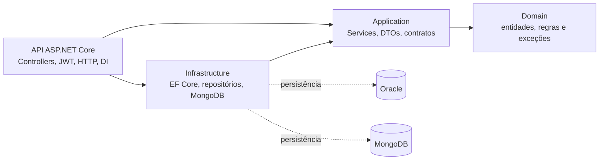

# ClyvoVet API — Sprint 4

API do Challenge FIAP 2026 para acompanhamento clínico e preventivo de pets. Gerencia tutores, funcionários, animais, consultas, vacinas, medicamentos e prescrições, com histórico de evoluções clínicas e avaliação preventiva por pet.

| Integrante | RM |
|---|---|
| Gabriel Garcia | 563298 |
| Andre Bellandi | 564662 |
| Vitor Augusto | 564227 |

## Arquitetura

A solução segue Clean Architecture, com regras de negócio no domínio, casos de uso na aplicação e persistência na infraestrutura. Os Controllers delegam aos Services; a injeção de dependência fornece as implementações dos repositórios.



As setas contínuas representam referências entre projetos.

| Projeto | Responsabilidade |
|---|---|
| `ClyvoVetApi.csproj` | Controllers, JWT, HATEOAS, tratamento global de exceções, observabilidade e configuração da DI |
| `src/ClyvoVetApi.Domain` | Entidades, regras preventivas e exceções; sem dependências de frameworks de persistência ou HTTP |
| `src/ClyvoVetApi.Application` | Services, validações, DTOs e interfaces dos repositórios |
| `src/ClyvoVetApi.Infrastructure` | EF Core, migrations Oracle, repositórios relacionais e documentais, health checks |
| `ClyvoVetApi.Tests.Unit` | Testes xUnit de domínio, aplicação, autenticação, modelo e dependências entre camadas |
| `ClyvoVetApi.Tests.Integration` | Testes HTTP, contratos REST, observabilidade e persistência |

O Oracle armazena os dados relacionais. O MongoDB armazena as evoluções clínicas imutáveis. A avaliação preventiva calcula score e recomendações; o serviço de background identifica vacinas pendentes e registra notificações simuladas nos logs.

## Requisitos e configuração

- SDK .NET 9 e runtime ASP.NET Core 9 (`net9.0`; seleção do SDK em `global.json`).
- Oracle 21 para os recursos relacionais e MongoDB para as evoluções clínicas.
- Docker com Compose, caso utilize os bancos locais descritos abaixo.

O projeto usa EF Core com provider Oracle, MongoDB.Driver, JWT Bearer, OpenAPI/Scalar, Serilog e OpenTelemetry. Os testes usam xUnit, Moq e Coverlet.

Copie `.env.example` para `.env` e preencha as credenciais. O Compose lê esse arquivo; `dotnet run` e a CLI do EF **não carregam `.env` automaticamente**. Para executar pelo SDK, configure as variáveis na sessão. Não versione segredos.

| Variável | Configuração |
|---|---|
| `ConnectionStrings__OracleConnection` | Conexão Oracle obrigatória fora dos testes; no Compose, use `oracle-db:1521/XEPDB1` |
| `Mongo__ConnectionString` | `mongodb://localhost:27017` no host; o Compose usa `mongodb://mongo-db:27017` |
| `Mongo__DatabaseName` / `Mongo__CollectionName` | Padrões: `clyvovet` / `evolucoes_clinicas` |
| `Auth__Username` / `Auth__Password` | Credenciais da conta clínica |
| `Auth__SigningKey` | Chave HMAC-SHA256 com pelo menos 32 bytes; utilize caracteres ASCII aleatórios |
| `Auth__Issuer` / `Auth__Audience` | Padrões: `ClyvoVetApi` / `ClyvoVetApiClients` |
| `Auth__ExpirationMinutes` | Padrão: 60; valores permitidos de 1 a 1440 |
| `ORACLE_PASSWORD`, `ORACLE_APP_USER`, `ORACLE_APP_PASSWORD` | Credenciais de inicialização do Oracle local no Compose |
| `OpenTelemetry__OtlpEndpoint` | Vazio desabilita OTLP; endpoint local de exemplo: `http://localhost:4317` |
| `OpenTelemetry__ConsoleExporter` | Padrão: `false`; habilitado em `Development` |

Sem usuário ou senha, o login retorna 401. Sem chave JWT, a API gera uma chave temporária, registra um aviso e invalida os tokens ao reiniciar. Uma chave informada com menos de 32 bytes impede a inicialização.

## Instalação e execução

Execute os comandos em PowerShell na raiz do repositório:

```powershell
git clone https://github.com/gabriel-g-dev/ClyvoVetApi.git
Set-Location ClyvoVetApi
dotnet restore ClyvoVetApi.sln
dotnet tool restore
dotnet build ClyvoVetApi.sln
```

Para criar um ambiente local novo, configure `.env` e inicie os bancos. Use um schema exclusivo: se já houver tabelas ou dados, consulte o [guia de banco](docs/database/README.md#banco-existente-e-alinhamento-com-andré) antes de aplicar qualquer migration. Variáveis da sessão prevalecem sobre `.env` no Compose; confira o destino configurado.

```powershell
if (-not (Test-Path -LiteralPath '.env')) { Copy-Item .env.example .env }
# Preencha .env antes de continuar.
docker compose config --quiet
docker compose up -d --wait oracle-db mongo-db

# Use o mesmo usuário e senha de ORACLE_APP_USER / ORACLE_APP_PASSWORD.
# A CLI executada no host acessa localhost, em vez do nome do serviço Docker.
$oracleHostConnection = 'User Id=<usuario-local>;Password=<senha-local>;Data Source=localhost:1521/XEPDB1'
dotnet ef database update --connection $oracleHostConnection --project src/ClyvoVetApi.Infrastructure --startup-project src/ClyvoVetApi.Infrastructure

# Inicie a API após a migration terminar com sucesso.
docker compose up -d --build api
```

A API **não aplica migrations ao iniciar**. A readiness verifica conectividade e não garante que as tabelas existam. O Compose mantém volumes dos bancos e publica Oracle em `127.0.0.1:1521`, MongoDB em `127.0.0.1:27017` e API na porta `8080`.

| Acesso local | Endereço |
|---|---|
| Interface OpenAPI (Scalar) | `http://localhost:8080/scalar/v1` |
| Documento OpenAPI | `http://localhost:8080/openapi/v1.json` |
| Liveness | `http://localhost:8080/health/live` |
| Readiness | `http://localhost:8080/health/ready` |

Para executar a API pelo SDK com os mesmos bancos e schema já preparados:

```powershell
$env:ConnectionStrings__OracleConnection = $oracleHostConnection
$env:Mongo__ConnectionString = 'mongodb://localhost:27017'
$env:Auth__Username = '<usuario-local>'
$env:Auth__Password = '<senha-local>'
$env:Auth__SigningKey = '<chave-aleatoria-com-pelo-menos-32-bytes>'
dotnet run --project ClyvoVetApi.csproj --no-launch-profile --urls http://localhost:5109
```

Nesse caso, substitua a origem dos exemplos por `http://localhost:5109`.

## Autenticação e endpoints

`POST /api/auth/login` recebe `username` e `password` e retorna `accessToken`, `tokenType` e `expiresAt`. Todas as operações de negócio exigem `Authorization: Bearer <token>` e a policy `ClinicalAccess`, com claim `scope=clinical`. O login representa uma conta clínica configurada por ambiente.

Os sete recursos relacionais oferecem `GET` paginado, `GET /{id}`, `POST`, `PUT /{id}` e `DELETE /{id}`:

| Recurso | Rota base | Consultas adicionais (GET) |
|---|---|---|
| Tutores | `/api/tutores` | `/email/{email}`, `/{id}/pets` |
| Funcionários | `/api/funcionarios` | `/email/{email}`, `/setor/{setor}`, `/cargo/{cargo}` |
| Pets | `/api/pets` | `/especie/{especie}`, `/raca/{raca}`, `/{id}/consultas`, `/{id}/vacinas`, `/{id}/inteligencia-preventiva` |
| Consultas | `/api/consultas` | `/funcionario/{funcionarioId}`, `/periodo?inicio=...&fim=...` |
| Vacinas | `/api/vacinas` | `/pendentes`, `/nome/{nome}`, `/proximas?dias=30` |
| Medicamentos | `/api/medicamentos` | `/nome/{nome}` |
| Prescrições | `/api/consultamedicamentos` | `/consulta/{consultaId}` |

As listagens principais aceitam `page` (1–1000000), `pageSize` (1–100), `search` (até 100 caracteres), `sortBy` e `descending`. Os padrões são página 1, tamanho 10 e ordem crescente por `id`. A busca ignora diferenças entre maiúsculas e minúsculas.

| Recurso | Campos de busca | Valores de `sortBy` |
|---|---|---|
| Tutores | nome, e-mail | `id`, `nome`, `email` |
| Funcionários | nome, e-mail, setor, cargo | `id`, `nome`, `email`, `setor`, `cargo` |
| Pets | nome, espécie, raça | `id`, `nome`, `especie`, `raca`, `datanascimento`, `peso` |
| Consultas | tipo, descrição | `id`, `data`, `tipo`, `status`, `valor` |
| Vacinas | nome | `id`, `nome`, `data`, `status` |
| Medicamentos | nome | `id`, `nome` |
| Prescrições | dosagem, nome do medicamento | `id`, `consultaid`, `medicamentoid`, `dosagem` |

As respostas paginadas contêm `data`, `page`, `pageSize`, `totalItems`, `totalPages` e links HATEOAS `self`, `first`, `last`, `prev` e `next`, conforme aplicável. Os links preservam filtros e ordenação. As consultas adicionais retornam arrays, com links nos itens e header `Link`.

Criações retornam 201 com `Location`; atualizações, 200; exclusões, 204. Erros usam ProblemDetails com `traceId`: 400 para validação, 401 para autenticação, 403 para autorização, 404 para recurso ausente, 503 para indisponibilidade documental e 500 para erro inesperado. OpenAPI, Scalar e health checks são públicos.

O request de pet utiliza `tutorId`; a resposta principal utiliza `donoId`, e a listagem de pets do tutor utiliza `tutorId`. Peso e valor aceitam até duas casas decimais significativas. Consultas por período exigem início e fim; vacinas próximas aceitam `dias` entre 1 e 3650.

### Exemplo de uso

```powershell
$baseUrl = 'http://localhost:8080'
$loginBody = @{ username = '<usuario-local>'; password = '<senha-local>' } | ConvertTo-Json
$token = (Invoke-RestMethod "$baseUrl/api/auth/login" -Method Post -ContentType 'application/json' -Body $loginBody).accessToken
Invoke-RestMethod "$baseUrl/api/pets?search=Gato&sortBy=nome&page=1&pageSize=5" -Headers @{ Authorization = "Bearer $token" }
```

```http
POST /api/pets
Authorization: Bearer <accessToken>
Content-Type: application/json

{"nome":"Mingau","especie":"Gato","raca":"SRD","dataNascimento":"2022-03-01","peso":4.2,"tutorId":1}
```

Use um tutor existente. A URL recebida em `Location` permite consultar o pet criado com o mesmo token.

## Persistência e evoluções clínicas

O modelo Oracle possui `DONOS`, `FUNCIONARIOS`, `PETS`, `CONSULTAS`, `MEDICAMENTOS`, `CONSULTAS_MEDICAMENTOS` e `VACINAS`. A migration ativa é `20261025155040_OracleBaseline`. O [guia de banco](docs/database/README.md) descreve a baseline, os SQL exportados, a inspeção de schemas existentes e os testes isolados.

`script_bd.sql` contém o DDL das sete tabelas atuais, com os checks de status corrigidos. `script.sql` e `docs/migrations-legadas` representam a modelagem anterior e foram preservados para alinhamento com André. Não aplique esses scripts em conjunto com a baseline. A adoção de um banco existente exige comparar o schema e definir a estratégia de migração com o responsável.

As evoluções clínicas no MongoDB contêm texto, autor extraído do JWT, data UTC e tags. São imutáveis e têm índice por pet/data/ID.

| Método e rota | Operação |
|---|---|
| `POST /api/pets/{petId}/evolucoes` | Registra texto de 1–4000 caracteres e até 10 tags de 1–40 caracteres |
| `GET /api/pets/{petId}/evolucoes` | Filtra por `tag`, `inicio` e `fim`; aceita `page`, `pageSize` e `direction=asc\|desc` |
| `GET /api/pets/{petId}/evolucoes/{id}` | Consulta documento pelo GUID de 32 caracteres, limitado ao pet |

```http
POST /api/pets/1/evolucoes
Authorization: Bearer <accessToken>
Content-Type: application/json

{"texto":"Retorno sem intercorrências; manter acompanhamento.","tags":["retorno","preventivo"]}
```

A criação verifica a existência do pet no Oracle antes de escrever no MongoDB. Não há transação distribuída nem chave de idempotência. Excluir o pet não remove suas evoluções; a retenção documental e os cascades relacionais devem ser alinhados com André. O MongoDB local do Compose não habilita autenticação.

## Observabilidade

`/health/live` verifica o processo; `/health/ready` verifica conectividade Oracle e ping MongoDB; `/health` reúne os checks. As respostas são sanitizadas e retornam 200 ou 503.

Serilog grava JSON no console e em `logs/clyvovet-.log`, com rotação diária e retenção de sete arquivos. `X-Correlation-Id` permite correlacionar resposta, logs e erros. OpenTelemetry instrumenta HTTP, runtime, Services e repositórios, com exportação opcional por console ou OTLP.

O Compose adicional disponibiliza Aspire Dashboard em `http://localhost:18888` e OTLP em `localhost:4317`, ambos publicados em loopback, e configura automaticamente o envio de telemetria da API para o Dashboard:

```powershell
docker compose -f docker-compose.yml -f docker-compose.observability.yml up -d --build
```

O Dashboard local permite acesso anônimo. Autenticação, segredos e acesso remoto aos serviços precisam de configuração própria para outro ambiente.

## Testes e cobertura

Os testes xUnit seguem Arrange, Act e Assert. A suíte HTTP comum usa SQLite em memória e um repositório documental em memória; os testes com providers reais são opcionais e separados por categoria.

```powershell
dotnet restore ClyvoVetApi.sln
dotnet build ClyvoVetApi.sln -c Debug
dotnet build ClyvoVetApi.sln -c Release

$debugResults = Join-Path (Get-Location) ('artifacts/TestResults/debug-' + [guid]::NewGuid().ToString('N'))
dotnet test ClyvoVetApi.sln -c Debug --no-build --collect:'XPlat Code Coverage' --results-directory $debugResults --logger trx
powershell -NoProfile -ExecutionPolicy Bypass -File scripts/coverage-summary.ps1 -ResultsDirectory $debugResults -OutputPath (Join-Path $debugResults 'coverage-summary.md')

dotnet test ClyvoVetApi.sln -c Release --no-build
```

Use um diretório novo por coleta para evitar misturar resultados. O [resumo de cobertura](docs/coverage-summary.md) apresenta a união das linhas executadas pelas suítes, incluindo Domain e Application.

Para testar MongoDB real em banco local descartável:

```powershell
docker compose -f docker-compose.tests.yml -p clyvovet-sprint4 up -d --wait mongo-test
$env:CLYVOVET_MONGO_TEST_CONNECTION = 'mongodb://localhost:27029'
dotnet test ClyvoVetApi.Tests.Integration --filter Category=MongoReal
```

Os testes criam bancos `clyvovet_tests_<GUID>` e removem somente esses bancos. O [guia Oracle](docs/database/README.md#testes-com-bancos-descartáveis) descreve o teste `Category=OracleReal`, na porta local 11521, que exige `CLYVOVET_ORACLE_TEST_CONNECTION` e `CLYVOVET_ORACLE_ALLOW_MIGRATIONS=true`.

Sem os opt-ins, os casos reais ficam explicitamente ignorados. Não configure conexões compartilhadas: os testes Oracle aplicam migrations e os testes Mongo criam e removem bancos descartáveis. A validação com SQLite e repositório em memória não substitui a execução com os providers reais.

`bin/`, `obj/`, `artifacts/`, `TestResults/`, logs e `.env` ficam fora do Git. Somente o resumo útil de cobertura é versionado; os resultados TRX e XML permanecem locais.
