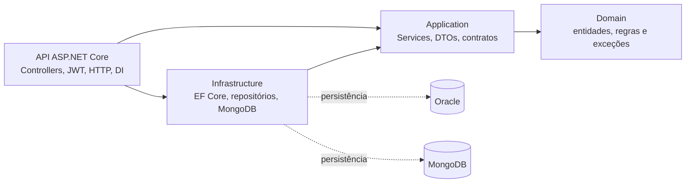

# ClyvoVet API — Sprint 4

Backend do Challenge FIAP 2026 para acompanhamento clínico e preventivo de pets.
Centraliza tutores, animais, consultas, vacinas, medicamentos e evoluções clínicas.
O histórico longitudinal e o score preventivo ajudam a clínica a identificar retornos e vacinas pendentes.

| Integrante | RM |
|---|---|
| Gabriel Garcia | 563298 |
| Andre Bellandi | 564662 |
| Vitor Augusto | 564227 |

## Arquitetura

A solução aplica Clean Architecture em quatro projetos de produção, com dependências verificadas por testes:



As setas contínuas representam referências entre projetos. Em execução, os Services usam interfaces e a DI fornece os repositórios concretos.

| Projeto / diretório | Responsabilidade |
|---|---|
| `ClyvoVetApi.csproj` na raiz | Controllers, autenticação, HATEOAS, ProblemDetails, observabilidade e composição da DI |
| `src/ClyvoVetApi.Domain` | Entidades relacionais e evolução clínica imutável; sem dependências de ASP.NET, EF ou Mongo |
| `src/ClyvoVetApi.Application` | Casos de uso, validação, DTOs e interfaces dos repositórios |
| `src/ClyvoVetApi.Infrastructure` | `AppDbContext`, migrations Oracle, repositórios EF/Mongo e health checks |
| `ClyvoVetApi.Tests.Unit` / `.Tests.Integration` | xUnit, padrão AAA, testes de regras, HTTP e persistência |

Os Controllers delegam as regras aos Services. A infraestrutura depende dos contratos da Application.
O cálculo preventivo permanece no Domínio; o `AlertScheduler` consulta vacinas pendentes em segundo plano.
Java e Mobile são aplicações independentes. Não há comunicação implementada com esses projetos; o mobile atual usa Supabase diretamente.

## Stack e requisitos

| Componente | Versão utilizada |
|---|---|
| .NET / ASP.NET Core | 9.0, alvo `net9.0`; SDK validado 9.0.317 |
| EF Core / Oracle provider | 9.0.4 / 9.23.60, compatibilidade SQL Oracle 21 |
| MongoDB.Driver / MongoDB real validado | 3.12.0 / 8.0.34 (também 8.0.16 na revisão anterior) |
| JWT Bearer / OpenAPI / Scalar | 9.0.21 / 9.0.21 / 2.14.14 |
| Serilog.AspNetCore / OpenTelemetry | 9.0.0 / 1.17.0 |
| xUnit / Moq / Coverlet collector | 2.9.3 / 4.20.72 / 6.0.4 |
| MVC Testing / SQLite de testes | 9.0.21 / EF 9.0.4 com bundle nativo 3.0.5 |

Instale o SDK .NET 9 e seu runtime ASP.NET Core. `global.json` aceita a feature band 9 mais recente instalada.
Oracle é necessário para executar os CRUDs; MongoDB é necessário para evoluções clínicas e readiness completo.
Docker é opcional para disponibilizar esses bancos localmente.

## Configuração por ambiente

Não versione credenciais. `.env.example` contém apenas exemplos; `.env`, logs e artefatos estão ignorados pelo Git.
A CLI .NET não carrega `.env` automaticamente: configure as variáveis na sessão ou use user-secrets.

| Variável | Uso / padrão |
|---|---|
| `ConnectionStrings__OracleConnection` | Obrigatória fora de `Testing`; conexão do schema Oracle autorizado |
| `Mongo__ConnectionString` | `mongodb://localhost:27017`; dentro do Compose, `mongodb://mongo-db:27017` |
| `Mongo__DatabaseName` / `Mongo__CollectionName` | `clyvovet` / `evolucoes_clinicas` |
| `Auth__Username` / `Auth__Password` | Credenciais da conta clínica configurada |
| `Auth__SigningKey` | Chave HMAC-SHA256 com pelo menos 32 bytes; use 32 ou mais caracteres ASCII aleatórios |
| `Auth__Issuer` / `Auth__Audience` | `ClyvoVetApi` / `ClyvoVetApiClients` |
| `Auth__ExpirationMinutes` | 60; intervalo permitido de 1 a 1440 |
| `ASPNETCORE_ENVIRONMENT` | `Development`, `Production` ou `Testing` |
| `OpenTelemetry__ConsoleExporter` | `false`; habilitado no arquivo de Development |
| `OpenTelemetry__OtlpEndpoint` | Vazio desabilita OTLP; exemplo local: `http://localhost:4317` |
| `ORACLE_PASSWORD`, `ORACLE_APP_USER`, `ORACLE_APP_PASSWORD` | Inicialização do Oracle local no Compose |

Sem usuário ou senha configurados, o login responde 401. Sem chave de assinatura, a API gera uma chave temporária e registra um aviso; os tokens deixam de valer após reiniciar.
Uma chave informada com menos de 32 bytes ou uma expiração fora do intervalo impede a inicialização.
No Oracle XE 21, use senhas ASCII fortes com até 30 caracteres para `ORACLE_PASSWORD` e `ORACLE_APP_PASSWORD`. A chave JWT possui um requisito diferente: pelo menos 32 bytes.

## Instalação e execução

Com Git, SDK .NET 9 e Docker/Compose instalados, comece em PowerShell:

```powershell
git clone https://github.com/gabriel-g-dev/ClyvoVetApi.git
Set-Location ClyvoVetApi
dotnet restore ClyvoVetApi.sln
dotnet tool restore
dotnet build ClyvoVetApi.sln
```

Para uma instalação local nova, copie o exemplo apenas se ainda não tiver `.env`, preencha seus segredos e suba primeiro os bancos. Use uma sessão dedicada: variáveis de ambiente da sessão prevalecem sobre `.env` no Compose. Se `ConnectionStrings__OracleConnection` já estiver definida para outro destino, ajuste conscientemente a sessão antes de continuar. O schema deve ser novo e exclusivo desse ambiente; se já houver dados ou tabelas clínicas, siga a seção de banco existente do [guia Oracle](docs/database/README.md).

```powershell
if (-not (Test-Path -LiteralPath '.env')) { Copy-Item .env.example .env }
# Preencha .env; a conexão da API no container usa oracle-db:1521/XEPDB1.
docker compose config --quiet
docker compose up -d --wait oracle-db mongo-db
# A CLI roda no host e não lê .env. Use o mesmo usuário/senha de ORACLE_APP_USER/ORACLE_APP_PASSWORD.
$oracleHostConnection = 'User Id=<usuario-local>;Password=<senha-local>;Data Source=localhost:1521/XEPDB1'
dotnet ef database update --connection $oracleHostConnection --project src/ClyvoVetApi.Infrastructure --startup-project src/ClyvoVetApi.Infrastructure
# Só depois de a migration terminar com sucesso, inicie a API.
docker compose up -d --build api
```

A API **não aplica migrations ao iniciar**. A conexão passada por `--connection` ao EF aponta para `localhost` sem alterar as variáveis de ambiente usadas pelo Compose; a API no container usa `oracle-db`, o nome de serviço Docker. A readiness verifica conectividade e pode responder 200 antes de existirem tabelas, portanto não substitui a etapa de migration.

Para conferir a documentação e autenticar a conta configurada no `.env`:

```powershell
$baseUrl = 'http://localhost:8080'
Invoke-RestMethod "$baseUrl/openapi/v1.json"
$loginBody = @{ username = '<usuario-local>'; password = '<senha-local>' } | ConvertTo-Json
$token = (Invoke-RestMethod "$baseUrl/api/auth/login" -Method Post -ContentType 'application/json' -Body $loginBody).accessToken
Invoke-RestMethod "$baseUrl/api/pets?page=1&pageSize=5" -Headers @{ Authorization = "Bearer $token" }
```

A interface Scalar fica em `http://localhost:8080/scalar/v1`. Os exemplos de CRUD e evoluções abaixo usam o mesmo token; as suítes da seção de testes verificam operações e contratos. A coleção Mongo é criada no primeiro uso documental, sem migration relacional adicional.

Como alternativa, mantenha os bancos e o schema preparados acima e execute a API pelo SDK. Configure também as credenciais na sessão, pois `dotnet run` não lê `.env`:

```powershell
$env:ConnectionStrings__OracleConnection = $oracleHostConnection
$env:Mongo__ConnectionString = 'mongodb://localhost:27017'
$env:Auth__Username = '<usuario-local>'
$env:Auth__Password = '<senha-local>'
$env:Auth__SigningKey = '<chave-aleatoria-com-pelo-menos-32-bytes>'
dotnet run --project ClyvoVetApi.csproj --no-launch-profile --urls http://localhost:5109
```

Nesse caso, use `http://localhost:5109` como origem para OpenAPI, Scalar e os exemplos HTTP. Se os bancos forem fornecidos por outro ambiente autorizado, configure suas conexões na sessão e prepare o schema novo conforme o guia, sem precisar do Docker local.

O Compose principal disponibiliza Oracle XE 21 em `127.0.0.1:1521`, MongoDB em `127.0.0.1:27017` e API na porta 8080, com volumes persistentes. Os bancos aceitam acesso pelo host local; acesso remoto exige configuração explícita acordada com André. A comunicação entre containers usa os nomes de serviço da rede Docker.
A imagem da API usa build em estágios e usuário `app`, sem privilégios.
Os arquivos principal, testes e principal com observabilidade passaram por `config --quiet` com Compose oficial 5.6.0, cujo SHA256 foi conferido. O build real da imagem passou sem avisos ou erros no Docker temporário do WSL; o runtime confirmou usuário `app` (UID 1654), logs JSON/arquivo e HTTP antes e depois do restart da API: live/ready/OpenAPI 200 e GET clínico anônimo 401.

O daemon isolado usado na auditoria mantém forwarding e regras Docker de firewall desabilitados. Por isso o runtime usou um override temporário em que somente os três containers novos compartilham um namespace de rede privado, com portas de host em `127.0.0.1`. A rede bridge padrão do Compose permanece sem comprovação nesse ambiente. Os containers e volumes desse projeto foram removidos ao final. A restrição posterior dos bindings versionados de Oracle/Dashboard a loopback foi conferida novamente nos três arranjos com `config --quiet`, sem recriar containers; a rede entre containers e a publicação da API 8080 permaneceram iguais.

## Autenticação e contratos HTTP

`POST /api/auth/login` recebe `username` e `password` e devolve `accessToken`, `tokenType` e `expiresAt`.
Envie `Authorization: Bearer <token>` em todas as operações dos recursos de negócio, inclusive GET.
A policy `ClinicalAccess` exige JWT válido e claim `scope=clinical`, emitida pelo login da API.
Token ausente, inválido ou expirado resulta em 401; token válido sem essa permissão resulta em 403.

A autenticação atual representa uma única conta clínica por ambiente. Não há cadastro de usuários nem isolamento de registros por tutor.
Tokens antigos sem a claim clínica precisam ser renovados pelo login. OpenAPI, Scalar e health checks permanecem públicos.

Os sete recursos relacionais expõem `GET` paginado, `GET /{id}`, `POST`, `PUT /{id}` e `DELETE /{id}`:

| Recurso | Rota base | Consultas adicionais |
|---|---|---|
| Tutores / `DONOS` | `/api/tutores` | `/email/{email}`, `/{id}/pets` |
| Funcionários | `/api/funcionarios` | `/email/{email}`, `/setor/{setor}`, `/cargo/{cargo}` |
| Pets | `/api/pets` | `/especie/{especie}`, `/raca/{raca}`, `/{id}/consultas`, `/{id}/vacinas`, `/{id}/inteligencia-preventiva` |
| Consultas | `/api/consultas` | `/funcionario/{funcionarioId}`, `/periodo?inicio=...&fim=...` |
| Vacinas | `/api/vacinas` | `/pendentes`, `/nome/{nome}`, `/proximas?dias=30` |
| Medicamentos | `/api/medicamentos` | `/nome/{nome}` |
| Prescrições | `/api/consultamedicamentos` | `/consulta/{consultaId}` |

`/api/donos` não é uma rota disponível. O contrato anterior foi preservado: o request de pet usa `tutorId`; `PetResponseDto` usa `donoId`, enquanto `PetDto` retornado na lista de pets do tutor mantém `tutorId`.
As consultas de período exigem início e fim; vacinas próximas aceitam `dias` entre 1 e 3650. IDs de relacionamento devem ser positivos, e as datas dos DTOs relacionais devem ser a partir de 1900.
`peso` e `valor` aceitam no máximo duas casas decimais significativas: `12.3400` é válido e `12.345` recebe 400, evitando arredondamento silencioso nas colunas Oracle.

As listagens principais aceitam `page` (1–1000000), `pageSize` (1–100), `search`, `sortBy` e `descending` (`true`/`false`).
Padrões: página 1, tamanho 10, ordenação por `id` crescente. A busca tem até 100 caracteres e é aplicada antes da contagem e paginação.

| Recurso | Busca textual sem distinção de maiúsculas | `sortBy` permitido |
|---|---|---|
| Tutores | nome, e-mail | `id`, `nome`, `email` |
| Funcionários | nome, e-mail, setor, cargo | `id`, `nome`, `email`, `setor`, `cargo` |
| Pets | nome, espécie, raça | `id`, `nome`, `especie`, `raca`, `datanascimento`, `peso` |
| Consultas | tipo, descrição | `id`, `data`, `tipo`, `status`, `valor` |
| Vacinas | nome | `id`, `nome`, `data`, `status` |
| Medicamentos | nome | `id`, `nome` |
| Prescrições | dosagem, nome do medicamento | `id`, `consultaid`, `medicamentoid`, `dosagem` |

Campos de ordenação desconhecidos e parâmetros inválidos recebem 400. As consultas usam parâmetros EF e desempate por ID; a ordenação textual segue a collation do banco.
Os filtros especializados anteriores continuam disponíveis e mantêm respostas em array.

Nas consultas, os DTOs incluem `links` com `href`, `rel` e `method`. Páginas incluem `self`, `first`, `last` e, quando aplicável, `prev`/`next`, preservando filtros e ordenação.
Arrays continuam arrays, com links nos itens e header HTTP `Link` para `self`. Os links são relativos à origem da API e respeitam `PathBase`.

Criação retorna 201 com `Location`; atualização retorna 200; exclusão retorna 204. Erros usam ProblemDetails com `traceId`: 400 para validação/regra, 401/403 para acesso, 404 para recurso ausente, 503 para falha do armazenamento documental e 500 para falha inesperada.

### Exemplos HTTP

```http
POST /api/auth/login
Content-Type: application/json

{"username":"<usuario-local>","password":"<senha-local>"}
```

```http
GET /api/pets?search=Gato&sortBy=nome&descending=true&page=1&pageSize=5
Authorization: Bearer <accessToken>
X-Correlation-Id: exemplo-sprint4
```

```http
POST /api/pets
Authorization: Bearer <accessToken>
Content-Type: application/json

{"nome":"Mingau","especie":"Gato","raca":"SRD","dataNascimento":"2022-03-01","peso":4.2,"tutorId":1}
```

Use IDs existentes no seu ambiente. O `Location` da criação e os links recebidos podem ser consultados com o mesmo token.

## Oracle e migrations

O EF mapeia `DONOS`, `FUNCIONARIOS`, `PETS`, `CONSULTAS`, `MEDICAMENTOS`, `CONSULTAS_MEDICAMENTOS` e `VACINAS`.
A migration ativa `20261025155040_OracleBaseline` e o snapshot refletem o modelo atual. Migrations antigas foram preservadas como texto em `docs/migrations-legadas`.

O [guia de banco](docs/database/README.md) distingue schema novo de banco existente e descreve exportação, aplicação e teste Oracle.
Para um schema novo, use a baseline. Para um banco existente, o responsável deve comparar o schema, fazer backup e decidir entre adoção de baseline no histórico ou migração incremental; não execute o DDL de criação sobre tabelas existentes.
A baseline recusa schemas com tabelas clínicas preexistentes. Não execute seu rollback `Down` em banco compartilhado.

`script_bd.sql` e `script.sql` foram preservados para revisão com Database/DevOps. Os checks de `script_bd.sql` possuem problemas de aspas; `script.sql` descreve uma modelagem legada com `TUTORES` e não deve ser aplicado junto da baseline atual. O guia fornece DDL corrigido em `docs/database`.

A baseline foi aplicada em Oracle XE 21 real e descartável. O teste confirmou segunda execução de `MigrateAsync`, nova conexão, grafo clínico, constraints, busca, paginação e ordenação decimal por peso/valor. Um restart real do container preservou um marcador confirmado e o histórico EF; somente o marcador próprio foi removido depois. Isso valida criação do zero; a adoção de um banco existente continua dependendo da comparação e aprovação do responsável por Database.

## MongoDB: evoluções clínicas

A coleção documental armazena anotações clínicas imutáveis com ID, `petId`, texto, autor do JWT, data UTC e tags.
É um complemento narrativo ao histórico relacional, com repositório concreto, índice por pet/data/ID e consulta paginada.
Na criação, tags repetidas são deduplicadas sem diferenciar maiúsculas; o filtro `tag` diferencia maiúsculas e corresponde ao valor armazenado.

| Método e rota | Operação |
|---|---|
| `POST /api/pets/{petId}/evolucoes` | Registra texto de 1–4000 caracteres e até 10 tags de 1–40 caracteres |
| `GET /api/pets/{petId}/evolucoes` | Filtra por `tag`, `inicio`, `fim`; aceita `page`, `pageSize`, `direction=asc\|desc` |
| `GET /api/pets/{petId}/evolucoes/{id}` | Consulta documento pelo ID GUID no formato de 32 caracteres, limitado ao pet |

```http
POST /api/pets/1/evolucoes
Authorization: Bearer <accessToken>
Content-Type: application/json

{"texto":"Retorno sem intercorrências; manter acompanhamento.","tags":["retorno","preventivo"]}
```

A criação verifica o pet no Oracle e faz uma única escrita no Mongo. Não atualiza o Oracle nem simula transação distribuída.
Mongo indisponível produz 503, sem afirmar que houve gravação. Um timeout após envio pode deixar o resultado incerto; não há chave de idempotência, então uma repetição pode duplicar a anotação.
A exclusão do pet não apaga suas evoluções: elas continuam consultáveis por profissionais autenticados. Uma exclusão concorrente à criação também não é transacional entre bancos.
Retenção e eventual remoção documental precisam de uma política acordada antes de uso operacional.
No MongoDB real, sete testes verificaram persistência e consulta em 8.0.16 e novamente em 8.0.34. Na revisão de 25/10, um restart do processo 8.0.16 também preservou documento e índice. O Compose local não habilita autenticação MongoDB: nomes DNS, portas, autenticação e retenção precisam ser definidos para outro ambiente.

## Observabilidade

| Rota | Verificação |
|---|---|
| `/health/live` | Processo em execução; não depende dos bancos |
| `/health/ready` | Conectividade Oracle e ping MongoDB; 200 ou 503 |
| `/health` | Agrega liveness e readiness, com duração e correlação |

Os checks usam limites de tempo e respostas sanitizadas. Uma dependência indisponível não derruba a sonda de liveness.
Readiness verifica conectividade; uma resposta 200 não substitui a preparação e conferência do schema clínico.
Serilog grava JSON no console e em `logs/clyvovet-.log`, com rotação diária e retenção de sete arquivos.
`X-Correlation-Id` identifica a requisição nos logs, resposta e ProblemDetails. O middleware valida o header e usa um identificador gerado quando necessário.
OpenTelemetry instrumenta HTTP/runtime e spans próprios de Services e repositórios; traces e métricas podem sair no console ou via OTLP.
Há métricas de duração HTTP e `clyvovet.http.errors`. O Compose de observabilidade disponibiliza Aspire Dashboard em `http://localhost:18888`; Dashboard e OTLP são publicados somente em `127.0.0.1:18888` e `127.0.0.1:4317`. O Dashboard local permite acesso anônimo; exposição remota exige configuração explícita e revisão de autenticação com André.

```powershell
docker compose -f docker-compose.yml -f docker-compose.observability.yml config --quiet
# API no Compose: configure OpenTelemetry__OtlpEndpoint=http://aspire-dashboard:18889.
# API fora do Compose: use http://localhost:4317.
```

## Testes, cobertura e evidências

Validação final de **26/10/2026**, em cópia limpa dos arquivos da futura entrega e cache NuGet novo: restore, builds Debug/Release e publish sem avisos ou erros. **Debug e Release aprovaram, cada um, 197 testes unitários e 241 de integração: 438 aprovados, zero falhas e zero ignorados**, com Oracle e Mongo reais habilitados. São 438 casos distintos, executados nas duas configurações; a revisão de 25/10 já havia obtido os mesmos totais.
Os sete testes `MongoReal` passaram contra MongoDB 8.0.34 real e descartável, incluindo escrita/leitura via HTTP, filtros, paginação e health check. `OracleReal` passou contra Oracle XE 21.3; a CLI também aplicou a baseline em schema novo e confirmou a segunda aplicação sem mudanças. As evidências de restart dos dois bancos pertencem à revisão de 25/10. O [resumo sanitizado versionável](docs/validation/sprint4-results.json) distingue essas execuções.
A suíte HTTP comum usa SQLite em memória e um substituto documental declarado; não comprova execução Oracle ou MongoDB por si só.

O processo nativo da cópia limpa completou ainda **90 requisições HTTP contra Oracle e Mongo reais**, com 333 verificações aprovadas: os sete CRUDs com `Location`, leitura posterior, PUT/DELETE, 401/403, 400 de precisão/filtros, 404, ordem decimal e paginação HATEOAS, inclusive parâmetros prefixados. O fluxo documental verificou autor do JWT e retenção após exclusão do pet. O roteiro usa ambiente ASP.NET `Testing`, com providers reais. O OpenAPI servido apresentou 34 paths, sem referências quebradas e com os valores padrão conferidos. O resumo sanitizado registra os resultados; `artifacts/audit3/native-http-report.json` é apenas o relatório bruto local complementar, ignorado pelo Git.

```powershell
dotnet build ClyvoVetApi.sln -c Debug
dotnet build ClyvoVetApi.sln -c Release
# Use um diretório novo por coleta; não misture XML/TRX de versões diferentes.
$debugResults = Join-Path (Get-Location) ('artifacts/TestResults/debug-' + [guid]::NewGuid().ToString('N'))
dotnet test ClyvoVetApi.sln -c Debug --no-build --collect:'XPlat Code Coverage' --results-directory $debugResults --logger trx
powershell -NoProfile -ExecutionPolicy Bypass -File scripts/coverage-summary.ps1 -ResultsDirectory $debugResults -OutputPath (Join-Path $debugResults 'coverage-summary.md')
$releaseResults = Join-Path (Get-Location) ('artifacts/TestResults/release-' + [guid]::NewGuid().ToString('N'))
dotnet test ClyvoVetApi.sln -c Release --no-build --results-directory $releaseResults --logger trx
```

O script de cobertura exige `-ResultsDirectory` explícito para impedir a mistura acidental de coletas.
`-ExecutionPolicy Bypass` vale apenas para esse processo PowerShell; não altera a política permanente da máquina.

Sem variáveis de opt-in, os testes `OracleReal` e `MongoReal` ficam ignorados. Para executar Mongo real com Docker:

```powershell
docker compose -f docker-compose.tests.yml -p clyvovet-sprint4 up -d --wait mongo-test
$env:CLYVOVET_MONGO_TEST_CONNECTION = 'mongodb://localhost:27029'
$mongoResults = Join-Path (Get-Location) ('artifacts/TestResults/mongo-' + [guid]::NewGuid().ToString('N'))
dotnet test ClyvoVetApi.Tests.Integration --filter Category=MongoReal --results-directory $mongoResults --logger trx
```

Os testes Mongo criam bancos `clyvovet_tests_<GUID>` e removem somente esses bancos descartáveis. Não informe uma conexão compartilhada.
O [guia Oracle](docs/database/README.md) mostra o ambiente isolado na porta 11521 e as duas variáveis exigidas para `--filter Category=OracleReal`, incluindo autorização explícita de migrations no schema de teste.
Para repetir a coleta completa sem casos ignorados, configure os dois opt-ins reais antes de executar a solução. O resumo versionável, os testes e os scripts necessários à reprodução fazem parte da entrega. TRX, XML de cobertura, logs e evidências brutas complementares ficam em `artifacts/audit2`, incluindo os restarts Oracle/Mongo e `docker-runtime/validation-summary.json`; esse diretório local é ignorado pelo Git e não é pré-requisito para restaurar, compilar ou testar o projeto.

| Assembly | Linhas cobertas / instrumentadas | Cobertura de linhas |
|---|---:|---:|
| Domain | 150 / 150 | 100,00% |
| Application | 854 / 857 | 99,65% |
| Infrastructure | 1536 / 1624 | 94,58% |
| API | 797 / 922 | 86,44% |

O [resumo de cobertura](docs/coverage-summary.md) une linhas executadas pelas suítes, sem somar percentuais. A métrica inclui DTOs e propriedades instrumentadas; não mede qualidade das assertions nem prova compatibilidade de provider.
Os testes cobrem regras de domínio/aplicação, JWT, 401/403, validações, filtros, ordenação, HATEOAS navegável, OpenAPI, erros, health checks, tracing e indisponibilidade.

A [auditoria da Sprint 4](docs/sprint4-audit.md) relaciona a rubrica às evidências e limites. Antes da integração com o grupo, alinhe com André o schema existente e sua eventual adoção da baseline, identidades/cascades, segredos, nomes de serviço, portas e autenticação MongoDB. A rede bridge padrão do Compose ainda precisa ser exercitada em um daemon com rede habilitada. Nenhuma nota automática ou promessa de 100/100 foi atribuída.
O [inventário da entrega](docs/validation/git-delivery.json) lista os arquivos novos que deverão acompanhar o futuro commit, incluindo os projetos internos, migrations, testes, configurações e evidências sanitizadas. Nenhum arquivo essencial está escondido pelo `.gitignore`.
Esta entrega foi preparada localmente, sem commit, push, deploy Azure ou alteração do banco compartilhado. Java, Mobile e arquivos originais de Database foram preservados.
